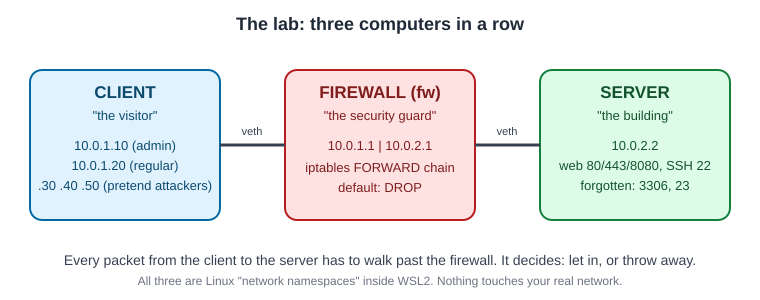
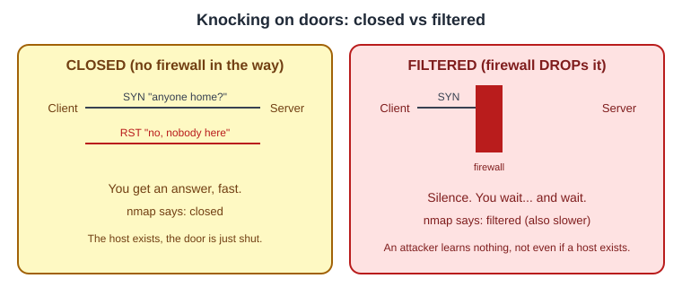
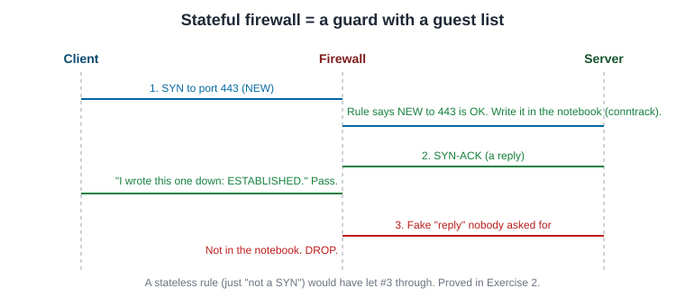
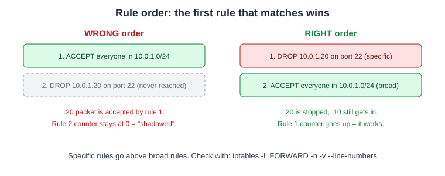
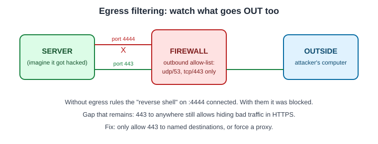

# Firewall Lab: learn how a firewall works by building one

A firewall is a **security guard for a computer network**. This lab builds a tiny network on one PC, puts a real Linux firewall (`iptables`) in the middle, and then tests it to see what it lets in, what it blocks, and why.

Everything runs inside WSL2 (Linux on Windows) in three pretend computers. **Nothing touches your real network.**

---

## 1. The big picture



- **Client** is someone knocking on the door (a visitor or an attacker).
- **Server** is the building with the valuable stuff (a website, SSH, and a couple of forgotten services).
- **Firewall** stands between them. Every packet has to pass it. It checks its rule list and either lets the packet through or throws it away.

The idea we keep coming back to is **default deny**: the guard blocks everything, and we only write rules for the few things that should be allowed.

---

## 2. What each exercise teaches

| # | Idea in plain words | What we proved | Files |
|---|---|---|---|
| 1 | **Default deny.** Block everything, then open only what is needed. | Only SSH from one admin IP and HTTPS are reachable. Before: 6 open ports. After: 2 (admin) or 1 (everyone else). | [notes.md](notes.md) |
| 2 | **Stateful vs stateless.** The guard keeps a guest list of conversations. | Fake "replies" get through a stateless rule but not a stateful one. | [script](scripts/ex2_stateful.sh), [output](evidence/ex2_stateful.txt) |
| 3 | **Rule order.** First matching rule wins. | A DROP rule placed under a broad ACCEPT never fires (it is "shadowed"). | [script](scripts/ex3_rule_order.sh), [output](evidence/ex3_rule_order.txt) |
| 4 | **Egress filtering.** Watch what goes *out*, not only what comes in. | A hacked server could not "phone home" on port 4444 once outbound was restricted. | [script](scripts/ex4_egress.sh), [output](evidence/ex4_egress.txt) |
| 5 | **Logging.** Write down what was blocked. | 17 dropped packets from 5 sources captured in the kernel log. | [script](scripts/ex5_logging.sh), [output](evidence/ex5_logging.txt) |
| 6 | **Troubleshooting.** A method for "the app can't reach the server". | A step-by-step checklist. | [TROUBLESHOOTING.md](TROUBLESHOOTING.md) |
| 7 | **Automation.** Python tools that read logs and audit rules. | Found scanners in logs, and 9 risky rules in a bad ruleset. | [parser](scripts/parse_fw_logs.py), [auditor](scripts/audit_rules.py) |

---

## 3. Exercise 1: closed vs filtered

When you knock on a door, two things can happen.



- **closed**: the computer answered "nobody here" (a `RST`). It is fast.
- **filtered**: nothing came back, because a firewall dropped the packet. You wait for a timeout, so scans get slower. Attackers learn less.

The rules (run on the firewall):

```bash
iptables -P FORWARD DROP                                   # default: throw everything away
iptables -A FORWARD -m conntrack --ctstate ESTABLISHED,RELATED -j ACCEPT   # replies to allowed chats
iptables -A FORWARD -s 10.0.1.10 -d 10.0.2.2 -p tcp --dport 22  -m conntrack --ctstate NEW -j ACCEPT   # SSH, admin only
iptables -A FORWARD -d 10.0.2.2 -p tcp --dport 443 -m conntrack --ctstate NEW -j ACCEPT                 # HTTPS, everyone
```

Result seen with `nmap`: before the firewall, ports 22, 23, 80, 443, 3306, 8080 were open. After it, `10.0.1.10` sees only 22 and 443 open, `10.0.1.20` sees only 443, and everything else shows `filtered`. `curl https://app.lab` works; `curl http://` (port 80) times out.

---

## 4. Exercise 2: the guard with a guest list



A **stateful** firewall remembers who started each conversation (`conntrack`). One rule, `ESTABLISHED,RELATED`, lets all legitimate replies back in.

Real output from the lab, with that rule deleted. The SYN goes out, the SYN-ACK comes back, the firewall drops it, and the client keeps retrying:

```text
fw-c  In  IP 10.0.1.10.49140 > 10.0.2.2.443: Flags [S]
fw-s  Out IP 10.0.1.10.49140 > 10.0.2.2.443: Flags [S]
fw-s  In  IP 10.0.2.2.443 > 10.0.1.10.49140: Flags [S.]   <- reply arrives, then is dropped
fw-c  In  IP 10.0.1.10.49140 > 10.0.2.2.443: Flags [S]    <- client retries
```

A "stateless" fix (allow anything that is not a SYN) made the web work again, but also let forged packets cross the firewall. Full output: [evidence/ex2_stateful.txt](evidence/ex2_stateful.txt).

---

## 5. Exercise 3: order matters



Real counters from the lab. In the wrong order, the DROP rule's counter stays at `0`:

```text
num   pkts bytes target  source        destination
1        4   216 ACCEPT  0.0.0.0/0     0.0.0.0/0     ctstate RELATED,ESTABLISHED
2        1    60 ACCEPT  10.0.1.0/24   10.0.2.2
3        0     0 DROP    10.0.1.20     10.0.2.2      tcp dpt:22      <- never matches
```

---

## 6. Exercise 4: outbound rules



---

## 7. Exercise 5: logging

The LOG rule sits last, so it only records packets that were about to be dropped. It is rate-limited so an attacker cannot fill the disk.

```bash
iptables -A FORWARD -m limit --limit 1000/min --limit-burst 2000 -j LOG --log-prefix "FW-DROP: " --log-level 4
```

Read the results with `dmesg | grep FW-DROP`. Sample: [samples/fw-drops.log](samples/fw-drops.log).

---

## 8. Exercise 7: tools that do the boring work

Real output of `python scripts/parse_fw_logs.py samples/fw-drops.log`:

```text
17 blocked packets parsed (0 non-matching lines ignored)

Possible port scans (>= 3 distinct ports from one source)
  10.0.1.20        4 distinct ports
  10.0.1.50        4 distinct ports
  10.0.1.30        3 distinct ports
```

`scripts/audit_rules.py` reads `iptables-save` and flags dangerous rules (allow-all, SSH or databases open to the whole internet, huge port ranges, shadowed rules). On the deliberately bad file `samples/risky.rules` it found 9 problems; on the lab's own rules it found only 1. Use `--fail-on high` to make it exit with code 1 in a CI pipeline.

Known limits: IPv4 iptables only, no nftables or cloud security groups, no hostname lookup.

---

## 9. Run it yourself

Requirements: Windows with WSL2 and Ubuntu.

```bash
wsl -d Ubuntu -u root -- bash -s < lab-up.sh        # build the three computers
cat scripts/common.sh scripts/ex2_stateful.sh | wsl -d Ubuntu -u root -- bash -s   # run an exercise
python scripts/parse_fw_logs.py samples/fw-drops.log
python scripts/audit_rules.py samples/risky.rules
```

Run any command inside the lab with `wsl -d Ubuntu -u root -- ip netns exec <client|fw|server> <command>`.

## 10. Words you might wonder about

| Word | Meaning |
|---|---|
| Packet | A small chunk of data travelling across a network |
| Port | A numbered door on a computer (22 = SSH, 443 = HTTPS) |
| DROP | Throw the packet away silently |
| SYN / SYN-ACK / RST | "Can we talk?" / "Yes" / "No, go away" |
| conntrack | The firewall's notebook of ongoing conversations |
| Egress | Traffic leaving your network |
| Namespace | A pretend computer inside Linux |

## Honest notes

- Screenshots are not included; the evidence is real captured terminal output in `evidence/` plus the diagrams above.
- Exercise 6 is a troubleshooting method ([TROUBLESHOOTING.md](TROUBLESHOOTING.md)).
- This is a learning lab, not a production firewall.
